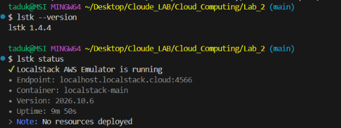
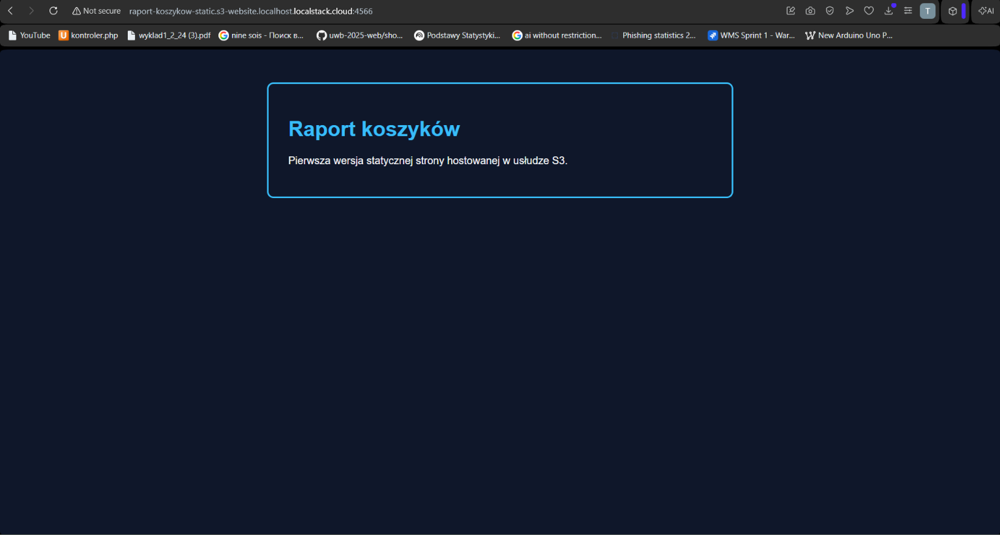
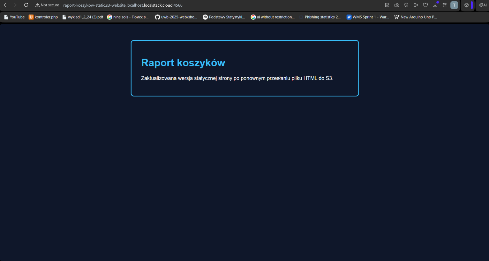
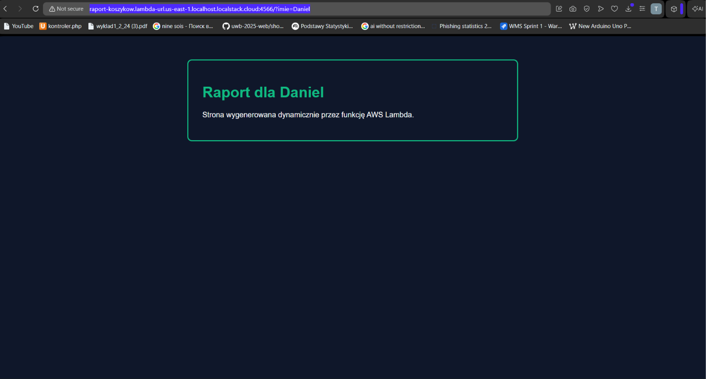
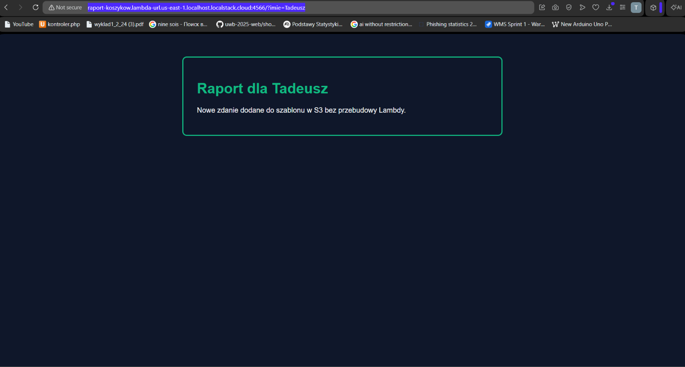

# Laboratorium LocalStack: S3 i AWS Lambda

Dokumentacja techniczna z realizacji ćwiczenia laboratoryjnego obejmującego wdrożenie hostingu strony statycznej w usłudze Amazon S3 oraz dynamicznego generatora stron HTML opartego na funkcji AWS Lambda pobierającej szablon z prywatnego bucketu S3 w środowisku emulacyjnym LocalStack.

---

## 1. Środowisko i nazwy zasobów

### Uruchomienie i weryfikacja środowiska LocalStack

Środowisko emulacyjne AWS zostało uruchomione w tle za pomocą narzędzia Docker Compose:

```bash
docker compose up -d
```

Weryfikację poprawności startu usług przeprowadzono poprzez odpytanie punktu kontrolnego kondycji (healthcheck):

```bash
curl -s http://localhost:4566/_localstack/health
```

W odpowiedzi potwierdzono status `"available"` dla usług `s3` oraz `lambda`.

Następnie zweryfikowano wersję narzędzia pomocniczego `lstk` oraz status kontenera LocalStack:

```bash
lstk --version
lstk status
```

Wynik poleceń w terminalu:

```text
$ lstk --version
lstk 1.4.4

$ lstk status
✔ LocalStack AWS Emulator is running
• Endpoint: localhost.localstack.cloud:4566
• Container: localstack-main
• Version: 2026.10.6
• Uptime: 9m 50s
> Note: No resources deployed
```

Potwierdzenie poprawnego stanu środowiska w terminalu:



### Zestawienie nazw zasobów

W ramach laboratorium utworzono i skonfigurowano następujące zasoby chmurowe:

| Typ zasobu | Identyfikator / Nazwa | Rola i konfiguracja |
| :--- | :--- | :--- |
| **Bucket S3 (publiczny)** | `raport-koszykow-static` | Hosting strony statycznej z polityką `s3:GetObject` dla każdego |
| **Bucket S3 (prywatny)** | `raport-koszykow-templates` | Magazyn szablonu `template.html` dostępny wyłącznie dla Lambdy |
| **Funkcja AWS Lambda** | `raport-koszykow-fn` | Runtime `python3.11`, handler `handler.lambda_handler` |
| **Lambda Function URL** | `raport-koszykow` | Publiczny punkt HTTP (`--auth-type NONE`) |
| **Adres strony statycznej** | `http://raport-koszykow-static.s3-website.localhost.localstack.cloud:4566/` | Dostęp przez przeglądarkę do hostingu S3 |
| **Adres strony dynamicznej** | `http://raport-koszykow.lambda-url.us-east-1.localhost.localstack.cloud:4566/` | Dostęp przez przeglądarkę do Function URL Lambdy |

---

## 2. Statyczna strona w S3

### Utworzenie bucketu i konfiguracja hostingu statycznego

W pierwszym etapie utworzono publiczny bucket S3 przeznaczony na pliki strony statycznej:

```bash
lstk aws s3 mb s3://raport-koszykow-static
```

Włączono tryb hostingu strony internetowej (Website Hosting), wskazując `index.html` jako dokument indeksu:

```bash
lstk aws s3 website s3://raport-koszykow-static --index-document index.html
```

W celu umożliwienia publicznego odczytu obiektów przez przeglądarkę zastosowano politykę bucketu zdefiniowaną w pliku `bucket-policy.json`:

```json
{
  "Version": "2012-10-17",
  "Statement": [
    {
      "Sid": "PublicReadGetObject",
      "Effect": "Allow",
      "Principal": "*",
      "Action": "s3:GetObject",
      "Resource": "arn:aws:s3:::raport-koszykow-static/*"
    }
  ]
}
```

Przypisanie polityki do bucketu:

```bash
lstk aws s3api put-bucket-policy --bucket raport-koszykow-static --policy file://bucket-policy.json
```

### Wdrożenie plików strony i weryfikacja w przeglądarce

Pliki strony (`index.html` oraz `style.css`) z katalogu lokalnego `www/` zsynchronizowano z bucketem S3:

```bash
lstk aws s3 sync www/ s3://raport-koszykow-static/
```

Stronę zweryfikowano w przeglądarce pod adresem `http://raport-koszykow-static.s3-website.localhost.localstack.cloud:4566/`:



### Test aktualizacji treści na hostingu statycznym

W celu sprawdzenia cyklu aktualizacji zmieniono treść akapitu w lokalnym pliku `www/index.html`:

```html
<p>Zaktualizowana wersja statycznej strony po ponownym przesłaniu pliku HTML do S3.</p>
```

Samo zapisanie pliku na dysku lokalnym nie wpłynęło na zawartość serwowaną przez serwer WWW S3. Aby zmiana została odzwierciedlona, przesłano zaktualizowany plik do bucketu:

```bash
lstk aws s3 cp www/index.html s3://raport-koszykow-static/index.html
```

Po ponownym załadowaniu strony w przeglądarce potwierdzono zaktualizowaną treść:



---

## 3. Dynamiczna strona przez AWS Lambda

### Utworzenie prywatnego bucketu i przesłanie szablonu HTML

Dla wariantu dynamicznego utworzono osobny, prywatny bucket S3 na szablon strony:

```bash
lstk aws s3 mb s3://raport-koszykow-templates
```

Przesłano plik szablonu `template.html` zawierający znacznik `{{IMIE}}`:

```bash
lstk aws s3 cp template.html s3://raport-koszykow-templates/template.html
```

### Przygotowanie paczki wdrożeniowej i utworzenie funkcji Lambda

Kod źródłowy funkcji (`lambda/handler.py`) spakowano do wymaganego archiwum `.zip`:

```bash
powershell -Command "Compress-Archive -Path lambda/handler.py -DestinationPath lambda/function.zip -Force"
```

Następnie utworzono funkcję Lambda `raport-koszykow-fn` w środowisku LocalStack:

```bash
lstk aws lambda create-function \
  --function-name raport-koszykow-fn \
  --runtime python3.11 \
  --zip-file fileb://lambda/function.zip \
  --handler handler.lambda_handler \
  --role arn:aws:iam::000000000000:role/lambda-role \
  --tags '{"_custom_id_":"raport-koszykow"}' \
  --environment "Variables={AWS_ENDPOINT_URL=http://localstack:4566}"
```

Dla funkcji wygenerowano publiczny adres HTTP (Function URL) bez wymogu autoryzacji sygnaturami AWS:

```bash
lstk aws lambda create-function-url-config \
  --function-name raport-koszykow-fn \
  --auth-type NONE
```

### Weryfikacja dynamicznego generowania stron w przeglądarce

Działanie funkcji przetestowano dla dwóch różnych wartości parametru `imie`:

1. **Dla wartości `Daniel` (`?imie=Daniel`):**
   Adres: `http://raport-koszykow.lambda-url.us-east-1.localhost.localstack.cloud:4566/?imie=Daniel`

   

2. **Dla wartości `Tadeusz` (`?imie=Tadeusz`):**
   Adres: `http://raport-koszykow.lambda-url.us-east-1.localhost.localstack.cloud:4566/?imie=Tadeusz`

   Na stronie wyświetlił się nagłówek „Raport dla Tadeusz” (zgodnie z nieodmienioną wartością parametru przekazaną w zapytaniu):

   

---

## 4. Odpowiedzi HTTP i weryfikacja szablonu w S3

### Weryfikacja odpowiedzi HTTP 200 OK

W celu zbadania nagłówków odpowiedzi HTTP oraz kompletnego kodu HTML wygenerowanego przez funkcję Lambda wykonano zapytanie narzędziem `curl`:

```bash
curl -i "http://raport-koszykow.lambda-url.us-east-1.localhost.localstack.cloud:4566/?imie=Tadeusz"
```

Odpowiedź serwera:

```http
HTTP/1.1 200 OK
Server: TwistedWeb/26.4.0
Date: Mon, 16 Nov 2026 22:14:48 GMT
Content-Type: text/html; charset=utf-8
Connection: keep-alive
x-amzn-requestid: 112863d2-6b6b-4794-a8f4-405ffd842420
x-amzn-trace-id: 324d901b-5919-4c18-80d6-b27ff59073c7
Content-Length: 610
x-localstack: 2026.10.6

<!DOCTYPE html>
<html lang="pl">
<head>
    <meta charset="UTF-8">
    <title>Raport koszyków</title>
    <style>
        body {
            font-family: Arial, sans-serif;
            background-color: #0f172a;
            color: #f8fafc;
            max-width: 650px;
            margin: 50px auto;
            padding: 30px;
            border: 3px solid #10b981;
            border-radius: 10px;
        }
        h1 { color: #10b981; }
    </style>
</head>
<body>
    <h1>Raport dla Tadeusz</h1>
    <p>Strona wygenerowana dynamicznie przez funkcję AWS Lambda.</p>
</body>
</html>
```

### Weryfikacja obsługi błędu HTTP 400 Bad Request

Przetestowano zachowanie funkcji w sytuacji, gdy parametr `imie` nie został przekazany w adresie URL:

```bash
curl -i "http://raport-koszykow.lambda-url.us-east-1.localhost.localstack.cloud:4566/"
```

Odpowiedź serwera:

```http
HTTP/1.1 400 BAD REQUEST
Server: TwistedWeb/26.4.0
Date: Mon, 16 Nov 2026 22:23:34 GMT
Content-Type: text/plain; charset=utf-8
Connection: keep-alive
x-amzn-requestid: 8f599d72-0d5d-4663-806d-7e1483b93e50
x-amzn-trace-id: 4caa0da5-e3c0-4cc2-ab26-1bd9f0b92b1e
Content-Length: 71
x-localstack: 2026.10.6

Błąd 400: Podaj niepusty parametr 'imie' w adresie URL, np. ?imie=Jan
```

Zwrócenie kodu błędu `400` oraz komunikatu tekstowego potwierdza poprawną walidację parametrów wejściowych w kodzie handlera.

### Aktualizacja szablonu w S3 bez przebudowy funkcji Lambda

W pliku `template.html` dopisano nową linię tekstu:

```html
<p>Nowe zdanie dodane do szablonu w S3 bez przebudowy Lambdy.</p>
```

Zaktualizowany szablon przesłano bezpośrednio do prywatnego bucketu S3:

```bash
lstk aws s3 cp template.html s3://raport-koszykow-templates/template.html
```

Weryfikacja pod adresem `http://raport-koszykow.lambda-url.us-east-1.localhost.localstack.cloud:4566/?imie=Tadeusz`:



W wyniku ponownego przesłania pliku poleceniem `lstk aws s3 cp template.html s3://raport-koszykow-templates/template.html` podmieniony został bezpośrednio obiekt **`template.html`** w prywatnym buckecie **`raport-koszykow-templates`**. Zmiana stała się widoczna natychmiast po odświeżeniu adresu Function URL, bez ponownego pakowania ani wdrażania kodu funkcji `raport-koszykow-fn`.

### Potwierdzenie zachowania znacznika w S3

Pobrano zawartość obiektu `template.html` bezpośrednio z bucketu S3 na standardowe wyjście terminala:

```bash
lstk aws s3 cp s3://raport-koszykow-templates/template.html -
```

Wynik z konsoli:

```html
<!DOCTYPE html>
<html lang="pl">
<head>
    <meta charset="UTF-8">
    <title>Raport koszyków</title>
    <style>
        body {
            font-family: Arial, sans-serif;
            background-color: #0f172a;
            color: #f8fafc;
            max-width: 650px;
            margin: 50px auto;
            padding: 30px;
            border: 3px solid #10b981;
            border-radius: 10px;
        }
        h1 { color: #10b981; }
    </style>
</head>
<body>
    <h1>Raport dla {{IMIE}}</h1>
    <p>Nowe zdanie dodane do szablonu w S3 bez przebudowy Lambdy.</p>
</body>
</html>
```

Wypisana zawartość jednoznacznie dowodzi, że plik w S3 nadal zawiera nienaruszony znacznik `<h1>Raport dla {{IMIE}}</h1>` i nie został nadpisany przetworzonymi danymi.

---

## 5. Wniosek

Na podstawie przeprowadzonych ćwiczeń sformułowano następujące wnioski:

1. **Kto dostarcza kod HTML w poszczególnych wariantach:**
   * **Wariant S3 Static Website:** Gotowy plik `index.html` serwuje bezpośrednio usługa Amazon S3 działająca jako statyczny serwer HTTP.
   * **Wariant Lambda Function URL:** Kod HTML jest składany dynamicznie w pamięci operacyjnej podczas obsługi żądania HTTP przez funkcję AWS Lambda, która w locie pobiera szablon `template.html` z S3 i podstawia wartość parametru zapytania `imie`.

2. **Kiedy wystarcza strona statyczna:**
   * Hosting statyczny w S3 jest optymalnym rozwiązaniem, gdy treść strony jest identyczna dla wszystkich odbiorców, nie zależy od parametrów zapytania URL ani zewnętrznych baz danych oraz nie wymaga wykonywania logiki biznesowej po stronie serwera (np. strony wizytówkowe, dokumentacja techniczna, blogi, landing page). Zapewnia to maksymalną wydajność, minimalne koszty i brak narzutu obliczeniowego.

3. **Dlaczego warto trzymać szablon w S3 osobno od kodu funkcji Lambda:**
   * **Separacja logiki od prezentacji:** Oddzielenie warstwy prezentacji (`template.html` w S3) od logiki aplikacji (Python w Lambdzie) pozwala na natychmiastową aktualizację wyglądu, stylów i treści strony bez konieczności ponownego tworzenia archiwum `.zip` i re-deployu funkcji Lambda.
   * **Bezpieczeństwo i bezstanowość (statelessness):** Sam szablon przechowywany w S3 pozostaje nienaruszony (wciąż zawiera znacznik `{{IMIE}}`). Dzięki temu pojedynczy obiekt w S3 i jedna instancja funkcji Lambda mogą w bezpieczny i współbieżny sposób obsługiwać wielu użytkowników o zróżnicowanych parametrach wejściowych bez ryzyka wyścigu danych (race conditions) czy wzajemnego nadpisywania treści.
